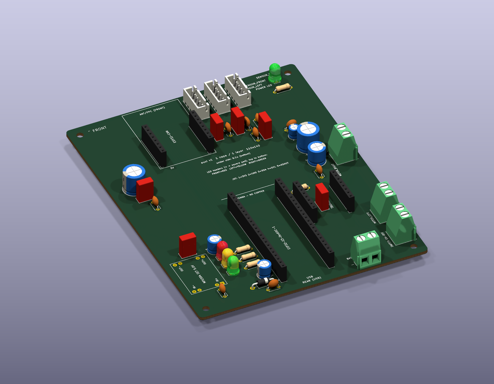

# auxi — Soccer Robot Controller Board

**auxi** is a small soccer robot: a first-semester university project. This repository holds the KiCad design for its single custom PCB.

> **Status: Stage 3 — printed chassis and wiring update.** The board itself is the same single-layer layout that was etched (it did **not** change). What changed is how it is used: the 4 LEDs are soldered on the board, the battery and the switch use the same screw terminal as the motors, and the chassis was 3D-printed (see [Section 5](#5-the-printed-chassis)). The schematic passes ERC with no errors or warnings, and the PCB passes DRC with **0 violations and 0 unconnected items**. The design is still **preliminary** until the purchased modules are measured (see [Section 16](#16-open-items)).

---

## 1. What auxi is for

**auxi** plays soccer in a university robot competition. A person drives it with an Xbox controller over Bluetooth Low Energy, and its front piece guides a ball while it pushes it. The competition rules shape the design: the robot must stay within 150 mm and 850 g, three colored LEDs must light when something is closer than 10 cm to each of its three distance sensors, and it must not interfere with other teams (for example with its Wi-Fi video).

It is also a learning project of a first-semester team, so simple, robust and easy-to-assemble solutions are preferred. This repository holds the electronics: **one custom PCB** that carries the controller modules, the motor driver, the power regulator, all connectors and the 4 LEDs. The chassis is printed separately (Section 5) and the firmware does not exist yet.

**Contents**

| Section | Title |
|---|---|
| 1 | What auxi is for |
| 2 | The robot |
| 3 | What is on the PCB |
| 4 | The board: one copper layer, soldered from below |
| 5 | The printed chassis |
| 6 | Why the pins moved |
| 7 | Power architecture |
| 8 | Pin map (GPIO) |
| 9 | LEDs (university rules and power LED) |
| 10 | Manufacturing rules for the home-made board |
| 11 | Building the board |
| 12 | Repository layout |
| 13 | Opening the project |
| 14 | Assembly warnings |
| 15 | Roadmap |
| 16 | Open items |

---

## 2. The robot

- **Drive:** 2 yellow TT gear motors plus 1 rear caster wheel.
- **Chassis:** 3D-printed, 144.1 mm long (limit 150 mm). The front is a printed **V or curved piece that guides the ball**. See [Section 5](#5-the-printed-chassis).
- **Two-level layout:**
  - **Bottom level (chassis):** base, motors with 63 mm wheels, caster, battery (at the rear, behind a door), ballast and wiring.
  - **Top level:** one **110 × 140 mm PCB** on four printed columns (M3 × 25 screws), 10 mm above the tray, above the batteries and motors.
- **Main MCU:** ESP32-S3-DevKitC-1 N16R8. It reads the sensors, drives the motors and LEDs, and receives commands from an **Xbox controller over Bluetooth Low Energy**. The ESP32-S3 has no Classic Bluetooth.
- **Camera:** AI Thinker ESP32-CAM. It streams live video over Wi-Fi to a phone and shows the distances it receives from the main ESP32 over UART. The OV2640 camera is a standard module with its ~2 cm flex, held in a printed cradle on the **camera arch** at the front of the chassis.
- **Sensors:** 3 × VL53L0X time-of-flight sensors (GY-530 modules) on printed supports at the front: FRONT (0°), LEFT (+45°) and RIGHT (−45°).
- **Proximity LEDs:** 3 LEDs soldered on the board, whose colors are set by the university rules. Each LED turns on when its sensor reads **≤ 100 mm**.

## 3. What is on the PCB

| On the PCB (plug-in modules and parts) | Off the PCB (connects through a connector) |
|---|---|
| ESP32-S3-DevKitC-1 (2 × 1×22 female headers) | 2S 18650 battery (**screw terminal** `J_BAT1`) |
| ESP32-CAM (2 × 1×8 female headers) | Power switch (screw terminal `J_SWITCH1`, in the switch tower) |
| TB6612FNG breakout (2 × 1×8 female headers) | 2 TT motors (screw terminals) |
| MP1584EN mini buck module (5.0 V) | 3 VL53L0X sensors (JST-XH 5P) |
| Capacitors, resistors, Schottky diode | OV2640 camera (flex cable into the ESP32-CAM) |
| **4 LEDs (5 mm), soldered directly on the board: 3 proximity + 1 green power** | |
| All connectors (**4 identical screw terminals**: 2 motors, switch, battery) | |

## 4. The board: one copper layer, soldered from below

The board is made for **home etching and hand drilling**, because most local fabs do not plate the holes.

- **One copper layer: `B.Cu` (the bottom face).** Every track is on the bottom. The rest of the bottom face is a **GND pour** (copper plane) that replaces the ground tracks.
- **All parts are through-hole (THT).** They go on the **top face** (the face without copper). Their legs go through the holes and are **soldered from below**, on the copper side. No hole needs plating, because there is nothing to connect on the top face.
- **No vias and no jumper wires.** The 167 tracks are all on `B.Cu`, and no track crosses another one.
- **Size: 110 × 140 mm**, 4 × M3 holes 5 mm from each corner, 2 mm rounded corners.
- **Orientation (given by the user, see the photo of the chassis):** the **110 mm side is the FRONT of the robot** (it sits between the two wheels) and the 140 mm side runs front to back. In KiCad the **top edge is the robot FRONT**, the bottom edge is the REAR, the left edge is the robot LEFT side and the right edge is the RIGHT side. The ESP32-CAM is at the front (camera looking forward) and the ESP32-S3 is at the rear.
- The `F.Cu` layer has no copper at all. A keepout covers the whole top face so no track or pour can appear there by mistake. Only the pads show on top.


3D view (the four LEDs and the four screw terminals as built):



### 4.1 Layout in one paragraph

Seen in KiCad (front of the robot = top edge):

- **Front (top):** the **ESP32-CAM** is at the front, almost centered (its centre is 14.5 mm to the left of the board centre), with its antenna and flex connector at the top edge, so the camera looks forward. The three **sensor connectors** are side by side along the top edge, to the right of the camera (LEFT, FRONT, RIGHT from left to right). A perfectly centered camera is not possible on one copper layer, because the 5 V and UART tracks of the camera would have to cross the sensor tracks.
- **Rear (bottom):** the **ESP32-S3** sits in the middle of the rear edge with its **USB end only 1 mm from the bottom edge** (user request: at most 2 mm). The USB-C plug overhangs the edge, so the cable plugs in without any obstacle.
- **East side:** the TB6612FNG is right next to the ESP32-S3 header row `J3` (short control signals), with the motor terminals on the right edge and the big capacitors, the green power LED (front right) and the battery/switch terminals on the east side and the bottom-right corner.
- **West side:** the MP1584, the 3 proximity LEDs (soldered directly on the board) and the big capacitor of the camera.
- The free areas between the groups are GND plane.

## 5. The printed chassis

The chassis is 3D-printed and its files live in the chassis project, not in this repository. This is what matters for the board:

| Item | Printed chassis |
|---|---|
| Size and weight | **144.1 mm long** (limit 150 mm). About **762.5 g** estimated with 3 ballast plates and the standard tray; target 800 g, **regulation limit 850 g**. Weigh the real robot |
| Drive | 2 TT motors in aluminium brackets, **63 mm wheels**, W420 rear caster |
| Battery | 2 protected 18650 cells in a holder **at the rear**, behind a door, so they can be charged without removing the board |
| PCB mounting | 4 printed columns with **M3 × 25** screws; printed spacers keep the board **10 mm above the tray** so cables pass under it |
| Camera | The **camera arch** rests on the two front corners of the PCB. Its cradle holds a standard 24-pin camera (lens forward, tilted 25° down) with its **~2 cm flex**, plugged into the ESP32-CAM below it. The long flex of the first plan is no longer needed |
| Switch | M6 toggle switch (≥ 3 A, ≥ 12 V DC) in the **switch tower** on the side, lever up. Its 20 AWG wires go straight into `J_SWITCH1` |
| Sensors | The GY-530 modules are bolted to printed supports at the front. Their wires are **soldered to the module from behind** (no connector at the sensor) and plug into the JST-XH connectors on the front edge of the board |
| Front | Printed V or curved piece that guides the ball (the curved one is recommended) |

**Cables.** They come up from the bottom level through the openings of the tray into the 10 mm gap, and reach their connector on the board. Never leave cables hanging over the wheels or in front of the front sensor or the camera, and tie them every 3–4 cm.

| Cable | Goes to | Wire |
|---|---|---|
| Battery | `J_BAT1` screw terminal (rear right) | 18–20 AWG. **Check polarity** |
| Motors | `J_MOTOR_LEFT1` / `J_MOTOR_RIGHT1` screw terminals (right edge) | 20–22 AWG |
| Switch | `J_SWITCH1` screw terminal | 20 AWG, never Dupont |
| Sensors | 3 × JST-XH on the front edge | 25 cm or less, I2C at 100 kHz |

**Pass-through holes.** The chassis design proposes three holes in the board (sensors, power, LEDs). **They were not added: the board that was etched did not change.** The LED hole is not needed any more, because the LEDs are now soldered on the board. See [Section 16](#16-open-items).

**To program the ESP32-CAM:** remove the two M3 × 25 screws of the arch legs and lift the arch (only ~3 mm are left above the front end of the module), open the latch of the flex, and take the module out.

## 6. Why the pins moved

A single layer cannot cross two tracks. To avoid any crossing (and any jumper wire), the GPIOs were **reassigned** so the signals leave the ESP32 headers in the same order as their destinations. The firmware has not been written yet, so this costs nothing. See the new table in [Section 8](#8-pin-map-gpio).

The mapping changed **once more** when the board orientation was fixed (110 mm side = front): the I2C pins and the camera UART pins moved to the order that the new layout needs, and the UART **TX and RX swapped places** (`GPIO18` is now the ESP32 transmit pin). Always check the table below.

## 7. Power architecture

```
BAT 2S (6.0–8.4 V) ─ screw terminal ─ external switch ─ +VBAT_SW
+VBAT_SW ─┬─ R1 1.5 kΩ ─ green power LED (soldered on the board)
          ├─ bulk caps ─ TB6612 VM (motors)
          └─ MP1584 ─ +5V ─┬─ D1 Schottky ─ +5V_ESP ─ ESP32-S3 5V pin
                           └─ ESP32-CAM 5V pin
ESP32-S3 3V3 pin ─ +3V3 ─ VL53L0X sensors, TB6612 logic (I2C pull-ups are on the GY-530 modules)
```

- Nothing connects to the battery before the switch. When the switch is off, the whole robot is off.
- D1 keeps the USB port and the robot from powering each other while you program the board.
- The firmware **must** limit motor PWM to **70 %**, which gives about 5.9 V average at 8.4 V.

## 8. Pin map (GPIO)

**Left header row (`U_ESP_J1`)**

| Signal | GPIO | Header pin |
|---|---|---|
| XSHUT_RIGHT | GPIO4 | J1-4 |
| XSHUT_FRONT | GPIO5 | J1-5 |
| XSHUT_LEFT | GPIO6 | J1-6 |
| SCL | GPIO7 | J1-7 |
| SDA | GPIO15 | J1-8 |
| UART_CAM_TO_ESP (ESP32 **RX**) | GPIO17 | J1-10 |
| UART_ESP_TO_CAM (ESP32 **TX**) | GPIO18 | J1-11 |
| LED_FRONT | GPIO8 | J1-12 |
| LED_LEFT | GPIO9 | J1-15 |
| LED_RIGHT | GPIO10 | J1-16 |

**Right header row (`U_ESP_J3`)**

| Signal | GPIO | Header pin |
|---|---|---|
| PWMB | GPIO1 | J3-4 |
| BIN2 | GPIO2 | J3-5 |
| BIN1 | GPIO42 | J3-6 |
| STBY | GPIO41 | J3-7 |
| AIN1 | GPIO40 | J3-8 |
| AIN2 | GPIO39 | J3-9 |
| PWMA | GPIO21 | J3-18 |

- I2C is **not** on the Arduino default pins any more: call `Wire.begin(15, 7)` (SDA = GPIO15, SCL = GPIO7).
- The camera UART is also not on the default `Serial1` pins: call `Serial1.begin(115200, SERIAL_8N1, 17, 18)` (RX = GPIO17, TX = GPIO18).
- Spare pins: GPIO11, 12, 13, 14 and 16.
- Still avoided on purpose: strapping pins (0, 3, 45, 46), USB (19, 20), console (43, 44), octal PSRAM (35, 36, 37), RGB LED (38, 48) and 47.
- R2 (10 kΩ to GND) still holds `STBY` low while the ESP32 boots, so the motors stay off.

## 9. LEDs (university rules and power LED)

| Sensor | LED color | Position on the board (top view, front at the top) | Pads |
|---|---|---|---|
| FRONT | Red | top | `J_LED_FRONT1` |
| LEFT | Yellow | middle | `J_LED_LEFT1` |
| RIGHT | Green | bottom | `J_LED_RIGHT1` |

A LED is **on** when its sensor reads ≤ 100 mm. It is **off** when the reading is above 100 mm, invalid or out of range. The firmware may average readings, but it must not use hysteresis that keeps a LED on above 100 mm.

**Decision (user): the three proximity LEDs are 5 mm LEDs soldered directly on the board**, in the pairs of holes marked `J_LED_FRONT1`, `J_LED_LEFT1` and `J_LED_RIGHT1` (no header and no Dupont jumpers). They are stacked on the west side, between the MP1584 and the ESP32-S3, top to bottom: FRONT (red), LEFT (yellow), RIGHT (green). In each pair of holes the **right hole** (the **square pad**, next to the resistor R3, R4 or R5) is the LED `+` (anode, the **long leg**) and the **left hole** is the `−` (cathode, the short leg and the flat side of the LED). A LED soldered backwards does not light and is not damaged. The robot has **no enclosure** (user decision): the board stays visible on top of the chassis, so the LEDs are visible as the university rules require and no windows or holes are needed. Solder them at a normal height.

The **power LED** is different. It is a **green** 5 mm LED **soldered directly on the board** too (user decision, Stage 3: it used to be an off-board LED on a 2-pin header with Dupont jumpers), in the pair of holes `J_LED_POWER1` at the front right of the board, next to its resistor `R1` (1.5 kΩ). Same polarity rule as the other LEDs: the **right, square hole** is `+` (long leg). `R1` gives about 2.6 mA at 6.0 V and 4.2 mA at 8.4 V with a classic green LED (2–3.6 mA with a bright one). Because the RIGHT proximity LED is also green, check that the two cannot be confused (they are on opposite sides of the board, and the power LED has the label `POWER LED`); if the rules require the indicator LEDs to be distinguishable, change the color of the power LED.

The 3D view of the board shows all four LEDs as colored 5 mm models (8.6 mm high), stored in `auxi.3dshapes/`.

## 10. Manufacturing rules for the home-made board

These rules were requested so the tracks survive etching and the pads keep copper after drilling by hand.

| Item | Rule | How it is enforced |
|---|---|---|
| Track width | **≥ 0.4 mm**, except **0.3 mm** where a track passes between pads or through a tight bundle | Net classes in `auxi.kicad_pro` and `auxi.kicad_dru`. KiCad refuses anything under 0.3 mm |
| Power tracks | `+5V`, `+5V_ESP`: 0.6 mm. Battery, switch, VM and motors: 1.2 mm | Net classes |
| Clearance | 0.2 mm between copper objects | DRC |
| Smallest hole | **0.3 mm** (the real smallest drill is 0.8 mm) | DRC rule `min_hole_0.3mm` |
| Pad size | **pad = drill + 0.8 mm** on every pad hole (0.4 mm of copper all around) | DRC rule `pad_ring_0.4mm` |
| Via | none are used. The default via is 1.1 mm pad / 0.3 mm hole (same 0.8 mm rule) | `auxi.kicad_pro` |
| Edge | 0.5 mm of copper clearance to the board edge | DRC |

Result in the final board: 167 tracks, of which **162 are 0.4 mm or wider** and **5 are 0.3 mm** (37 mm in total). The 0.3 mm tracks are the ones that squeeze between pad rows or run in tight bundles (I2C, UART and LED signals); the router could not widen them without breaking the 0.2 mm clearance.

### 10.1 Drill table

| Drill (mm) | Pad (mm) | Holes | Used by |
|---|---|---|---|
| 0.80 | 1.6 | 48 | Resistors and capacitors up to 8 mm |
| 0.95 | 1.75 × 1.95 | 15 | JST-XH sensor connectors |
| 1.00 | 1.8 (2.0 for the two 470 µF capacitors) | 96 | Female headers (ESP32-S3, ESP32-CAM, TB6612FNG), LED holes (4 pairs), MP1584 pins, 470 µF capacitors |
| 1.10 | 2.2 | 2 | 1N5819 diode |
| 1.30 | 2.6 | 6 | 5.08 mm screw terminals: motors ×2 and switch |
| 1.80 | 3.0 | 2 | Battery screw terminal (the pads still have the XT30 footprint, 5.0 mm pitch; the 5.08 mm terminal pins fit in the 1.8 mm holes) |
| 3.20 | no pad | 4 | M3 mounting holes (non-plated) |

Header pins are 0.64 mm square (0.9 mm diagonal), so a 1.0 mm hole is enough. Check the legs of your own parts before drilling: if a part is thicker than the hole, open that hole with the next bit size (the pad still keeps at least 0.3 mm of ring).

## 11. Building the board

1. Print the **B.Cu page** of [`docs/auxi_pcb_real_scale.pdf`](docs/auxi_pcb_real_scale.pdf) at **100 % scale** (no "fit to page"). The 100 mm ruler under the board must measure 100 mm.
   - **Page 2** is the copper **as seen from above** (not mirrored). For toner transfer, press the printed face against the copper. The result reads correctly from the copper side.
   - **Page 3** is the same copper **mirrored**, for methods where the sheet lies printed face up.
   - Black is copper. The small white dots in the pads are drill guides.
2. Etch, clean and drill (see the drill table). Drill from the copper side so the guide dots center the bit.
3. Mount the components on the **top face** and solder them **from below**. Order: low parts first (resistors, diode, ceramic capacitors), then electrolytic capacitors, then sockets and connectors.
4. Page 1 of the PDF shows where every part goes (top view with silkscreen and references).
5. Solder the 4 pins of the MP1584 **last**, after you set its output (see the warnings below).

The **USB end** of the ESP32-S3 is only **1 mm** from the rear board edge, so the plug overhangs the edge: keep the area around it free of tall parts and make sure nothing on the chassis blocks the cable at the rear (the plug and cable need about 15 × 12 mm). Use a low-profile **6.3 × 7 mm** capacitor for C9 (100 µF). The long `+3V3` and `+VBAT_SW` tracks run along the east side and the bottom strip of the board, away from the I2C and UART tracks.

## 12. Repository layout

| Path | Contents |
|---|---|
| `auxi.kicad_pro` | KiCad project, including the net classes and the design rules |
| `auxi.kicad_dru` | Custom DRC rules (pad ring and hole size) |
| `auxi.kicad_sch` | Schematic |
| `auxi.kicad_pcb` | Single-layer PCB (110 × 140 mm) |
| `auxi.kicad_sym` | Project symbol library (module header rows, etc.) |
| `auxi.pretty/` | Project footprint library. Four standard footprints were copied here with bigger pads (pad = drill + 0.8 mm). `MP1584_Mini_PROVISIONAL` has estimated pads |
| `auxi.3dshapes/` | 3D models of the 5 mm LEDs (red, yellow, green), used by the PCB |
| `sym-lib-table`, `fp-lib-table` | Project library tables |
| `auxi_drc_violations.json` | Last DRC report (empty list of violations) |
| `docs/auxi_esquematico.pdf` | Schematic PDF export |
| `docs/auxi_pcb_real_scale.pdf` | 1:1 prints: top view, copper, mirrored copper |
| `docs/auxi_bom_pcb.csv` | PCB BOM |
| `docs/auxi_pcb_top.png`, `docs/auxi_pcb_bottom.png`, `docs/auxi_pcb_placement.png` | 2D renders of the board |
| `docs/auxi_pcb_3d_top.png`, `docs/auxi_pcb_3d_iso.png` | 3D renders of the board |

The full design specification (confirmed decisions, power, pinout, connectors, capacitors, PCB rules and open items) is in [`CLAUDE.md`](CLAUDE.md). It is the source of truth for every design decision.

## 13. Opening the project

1. Install **KiCad 10**. The files use the KiCad 10 file format, so older versions cannot open them.
2. Open `auxi.kicad_pro`. The project libraries (`auxi`) load through the local `sym-lib-table` and `fp-lib-table` using `${KIPRJMOD}`.
3. The schematic points to the four custom `auxi:` connector footprints (bigger pads), so "Update PCB from Schematic" keeps them. Do not swap them back to the standard KiCad ones.

## 14. Assembly warnings

1. **Set the MP1584 to 5.0 V with a multimeter BEFORE plugging in any module.**
2. **Check battery polarity** (`BAT+` / `BAT−`) before connecting it. **The battery is a plain screw terminal now, not a keyed XT30 plug, so nothing prevents a reversed connection.** Mark the wires (red +, black −) and check with a multimeter before closing the switch.
3. **The switch path carries all of the robot's current.** Use 20 AWG wire and the screw terminal. Never use Dupont jumpers there. The same goes for the battery and the motors.
4. **Remove the ESP32-CAM to program it**, using the ESP32-CAM-MB programmer base.
5. **Motor PWM must never exceed 70 %.**
6. **Use protected 18650 cells**, or charge them outside the robot with a balancing 2S charger. The PCB has no BMS or charging circuit.
7. **Check every track under a magnifier** before soldering: with 0.2 mm gaps, a small etching defect can short two tracks. Check the 0.3 mm tracks for breaks as well.
8. **Solder the 4 LEDs with the right polarity**: the long leg (`+`) goes in the right, square hole of each pair. A LED soldered backwards does not light and is not damaged.

## 15. Roadmap

- [x] **Stage 1:** schematic, footprints and ERC
- [x] **Stage 2:** 110 × 140 mm single-layer PCB layout, DRC 0 violations
- [x] **Stage 3:** printed chassis, LEDs soldered on the board, 4 screw terminals (3D models, schematic texts and documents updated; the board itself did not change)
- [ ] Close the open items against the real purchased modules
- [ ] 2D space check (top and side views) inside the chassis, with real measurements
- [ ] Firmware (main ESP32-S3 and ESP32-CAM), using the pin map above

## 16. Open items

These need the real, purchased parts. See [`CLAUDE.md`](CLAUDE.md) (Section 20) for details.

1. Photos and measurements of the ESP32-S3 board if it is a clone (row spacing, RGB LED revision).
2. Pin order of the purchased TB6612FNG breakout (the SparkFun order was assumed). The layout depends on it.
3. Photo and measurements of the MP1584 module (its footprint is provisional).
4. GY-530 photos: the XSHUT voltage level (the modules already include the I2C pull-ups).
5. Measured stall current of the TT motor, to validate the driver, switch and wiring.
6. Green LED forward voltage, to set the final value of R5.
7. ESP32-CAM silkscreen, to confirm the pin order, and which end has the header pins.
8. The photo of the chassis shows that the **110 mm side is the front** (between the wheels) and the 140 mm side runs front to back. The robot is 144.1 mm long, so the 140 mm board nearly spans it. Still to check on the real chassis: does the board clear the front piece and the caster, does the USB cable at the rear edge have a way out, and does the camera arch sit on the two front corners as drawn?
9. The ESP32-CAM is at the front of the board, 14.5 mm to the left of the centre, and the camera sits in the arch right above its flex connector (standard ~2 cm flex). Confirm on the real robot that the flex reaches the cradle without strain.
10. Height of the capacitors that will be bought (C1, C3 and C11 are the tallest).
11. **Pass-through holes in the board** (sensors and power, proposed by the chassis design): decide whether the cables go around the board edge or whether the holes are drilled by hand (and added to KiCad, then DRC).
12. **Battery terminal:** it has 5.08 mm pins in the 5.0 mm pads of the old XT30 footprint. Confirm it fits without forcing it and which side its wire entry faces.
13. **Weight:** 762.5 g estimated, 850 g is the limit.
